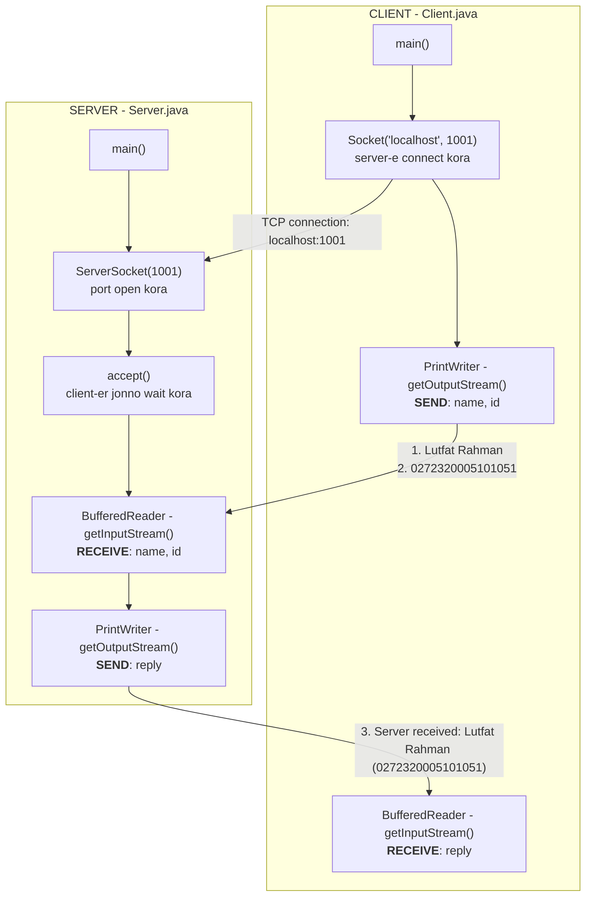

# Lab Final 1 - Client / Server (Socket)

Two separate programs in one project:

- `labfinal1.Server` - opens `ServerSocket` on port **1001**, waits for a client, receives name + id and sends a reply.
- `labfinal1.Client` - connects to `localhost:1001`, sends name + id and reads the reply.

Run the **server first**, then the client in a second terminal.

## Flowchart — kon tar sathe connect kore



Same chart as plain text (kon stream kothay jay):

```
   CLIENT (Client.java)                          SERVER (Server.java)
┌────────────────────────────┐            ┌────────────────────────────┐
│ Socket("localhost",1001)   │──connect──▶│ ServerSocket(1001)         │
│   │                        │            │   └─ accept() → Socket      │
│   ├─ getOutputStream()     │─name,id───▶│   ├─ getInputStream()       │
│   │    PrintWriter (SEND)  │            │   │    BufferedReader (READ)│
│   └─ getInputStream()      │◀──reply────│   └─ getOutputStream()      │
│        BufferedReader (READ)│            │        PrintWriter (SEND)  │
└────────────────────────────┘            └────────────────────────────┘
```

**Mone rakhar kotha:** `getOutputStream()` = pathano (SEND), `getInputStream()` = pora (RECEIVE). Duto side-e-i duto stream ase.

## Run (easiest - one command)

```bash
cd lab-final-1
./run.sh
```

`run.sh` kono `out`/`target` folder banay na — Java 17 `.java` file gulo direct run kore. Server + client duto-i chalay, output dekhai, ar server-e bondo kore diye. Tai fresh code-i cholche, kono cache nei.

## Or two terminals

```bash
# Terminal 1
./run-server.sh

# Terminal 2
./run-client.sh
```

Duto script-i `.java` file direct run kore — kono build folder lagbe na. Server age chalano lagbe.

## IDE (IntelliJ) run korle

IDE-r Run button `-cp .../target/classes` use kore. Tai IDE button chapar age ekbar:

```bash
./build.sh
```

Eta `target/classes`-e `Server.class` + `Client.class` banaye diye. Tarpor IDE-r
Run button chaple cholbe. Code change korechho tahole abar `./build.sh` chalao.

Terminal-e cholabar jonno `./run.sh` — eta `target` lagbe na, `.java` direct run kore.

## Not working hole

```bash
pkill -f 'java.*labfinal1.Server'   # old server thakle bondo koro
./run.sh                            # fresh code + run
```

The client sends `Lutfat Rahman` and `0272320005101051`; the server prints both and replies with them. Both programs then close.

## Viva / mam ask korle ei line gulo bolun

| Proshno | Uttor |
|---|---|
| Socket ki? | Duto program-er moddhe TCP connection; ek side likhle ar side pore. |
| ServerSocket ar Socket-e parthokko? | `ServerSocket` port open kore client-er jonno wait kore; `accept()`-er por jey `Socket` pawa jay, sei socket diye actually kotha hoy. |
| Port 1001 keno? | Client ar server-ei eki port number rakha lagbe — tai connect hoy. |
| Data kon side theke ashe? | Client `out.println()` diye name + id pathay; server `in.readLine()` diye ney. |
| Reply kon side theke ashe? | Server `out.println()` diye reply pathay; client `in.readLine()` diye ney. |
| BufferedReader keno? | `getInputStream()` raw byte dey; `InputStreamReader` byte→character kore; `BufferedReader.readLine()` ek line-e pore. |
| PrintWriter-e `true` keno? | AutoFlush — `println()` korar sathe-i data chole jay, buffer-e atke thake na. |
| Server age chalano keno lagbe? | Server na thakle client-er `new Socket(...)` connect korte parbe na, `Connection refused` dabe. |
| `readLine()` kothay atke jay? | Yeta na ashe, seta pore wait kore (blocking call). Tai client-er line order-i important: age name, por id. |
| `catch (IOException e)` keno? | Port busy, server offline, ba read/write fail — ei gulo handle kora jonno. |
| Connection kobe bondo hoy? | Client-e `socket.close()` ar server-e `serverSocket.close()` challei. |
# lab
